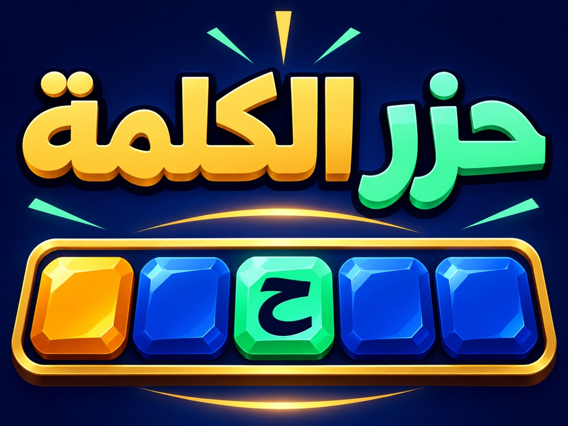

# حزر الكلمة · Hazzer Al-Kalima



[العب الآن](https://jabaliov.github.io/hazzer-al-kalima/) · [نسخة Scratch الأصلية](https://scratch.mit.edu/projects/1444047731/)

لعبة تخمين عربية من خمس خانات وست محاولات. تظهر فئة الكلمة بعد محاولتين، وتُحسب الحروف المكررة بحسب عدد مرات ظهورها في الحل. تضم اللعبة ٢٠٠ حل مصنّف وقاموسًا من ٥٤٠٬٠٥٧ تخمينًا مقبولًا.

## التشغيل محليًا

يتطلب الموقع متصفحًا حديثًا يدعم JavaScript modules و`DecompressionStream`. شغّل خادم ملفات من جذر المستودع وافتح http://localhost:8000.

```sh
python3 -m http.server 8000
node --test game.test.mjs
```

الموقع ثابت ومبني بـ HTML وCSS وJavaScript. يبدأ عرض الواجهة أثناء تحميل القاموس المضغوط (نحو ٣٠٦ كيلوبايت) من نفس الموقع. ينشر GitHub Pages محتويات جذر الفرع `main`.

## إمكانية الوصول

واجهة عربية باتجاه RTL، تدعم لوحة مفاتيح الجهاز واللمس والتنقل بلوحة المفاتيح. تُعرض نتائج الحروف برموز وألوان وأوصاف لقارئات الشاشة، ويُعلن تغيّر حالة الجولة عبر منطقة الحالة. استُخدمت [WCAG 2.2 AA](https://www.w3.org/TR/WCAG22/) مرجعًا للتصميم والتحقق.

## المصادر والحقوق

استُلهمت آلية اللعب من Wordle لجوش واردل. كلمات الحل والتصنيفات والقاموس مستخرجة من النسخة الأصلية على Scratch. القاموس المشتق من AyaSpell مرخّص بموجب [MPL 2.0](https://www.mozilla.org/MPL/2.0/). تُذكر المصادر في [إشعار القاموس](DICTIONARY-NOTICE.txt).

---

An Arabic word puzzle with 200 categorized answers, six attempts, and 540,057 accepted guesses. Built as a static, responsive site with no runtime frameworks.
